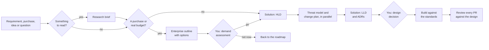

# Virtual Architects

A virtual architecture team for your repository: five AI architects (enterprise, solution,
cloud and infra, security, research) and a board that convenes them. They research,
design and review. One person, the decision maker, decides.

The team runs in **Claude Code** and **GitHub Copilot Chat**, with a build for the
**Microsoft 365 Copilot** app. Everything it knows about your project comes from one file
you fill in once, `docs/architecture/project.yaml`.

This repository holds two things:

- **The kit** ([`kit/`](kit/)): the agents, commands, templates and tools, laid out
  exactly as they land in your repository.
- **The site**: a static Next.js site that explains the team to the person deciding
  whether to adopt it, and hands the developer the install.

## Contents

- [The team](#the-team)
- [How a change moves through the team](#how-a-change-moves-through-the-team)
- [Diagrams as code](#diagrams-as-code)
- [Tools we use](#tools-we-use)
- [Install the team](#install-the-team)
- [What lands in your repository](#what-lands-in-your-repository)
- [Run the site](#run-the-site)
- [Edit the site](#edit-the-site)
- [How the kit is built](#how-the-kit-is-built)
- [Repository layout](#repository-layout)
- [License](#license)

## The team

| Architect | Lane | Writes | Command |
|---|---|---|---|
| **Enterprise** | Capabilities, roadmap, vendors, build vs buy, regulation | Outlines, roadmaps, cross-system ADRs | `/arch-enterprise` |
| **Solution** | Feature design, APIs, data models, design review | HLD, LLD (the SAD), feature ADRs | `/arch-solution`, `/arch-doc` |
| **Cloud and infra** | Compute, network, databases, pipelines, cost, reliability | Change plans, cost tables, infra ADRs | `/arch-cloud-infra` |
| **Security** | Threat models, auth, personal data, secrets, compliance | Threat models, security ADRs | `/arch-security` |
| **Research** | Reads a link, document or open question first | Research briefs, the question bank | `/arch-research` |

The other commands:

| Command | What it does |
|---|---|
| `/arch-board` | Convenes every architect a question touches, in parallel, and returns one recommendation with the disagreements left in |
| `/arch-profile` | Writes or updates `project.yaml` from the repository and a few questions |
| `/arch-doc` | Writes the HLD and LLD for a feature, an integration or the full system |
| `/arch-conform` | Checks code against the project's standards and fixes the breaches |
| `/arch-sync` | Regenerates the Copilot copies from the Claude Code sources |

Every lasting decision becomes an ADR in one shared log, `docs/architecture/decisions/`,
and stays a proposal until the decision maker accepts it. No architect commits or pushes.

## How a change moves through the team

Every request takes the same path, and small changes skip the steps they don't need.



The kit's handbook, [`kit/docs/architecture/README.md`](kit/docs/architecture/README.md),
has the full workflow and who is responsible for each kind of document.

## Diagrams as code

Every diagram the team draws is code that lives next to the text it explains. There is no
hand drawn picture and no ASCII art, so a diagram is reviewed in the same pull request as
the change and can never drift silently out of date.

### Two kinds of diagram

1. **A Mermaid block in the Markdown.** This is the default, and it needs nothing set
   up. The block carries two comments, which Mermaid ignores and the exporter reads:

   ````markdown
   ```mermaid
   flowchart LR
   %% id: FIG-2
   %% caption: The payment provider sits behind one adapter.
       App --> Adapter --> Provider
   ```
   ````

   `%% id` labels the figure and `%% caption` describes it. Flows are laid out
   `flowchart LR` so they read left to right and print on one page. GitHub renders the
   block as it is, like the one above.

2. **A view from your own diagram pipeline.** If your project already keeps its
   architecture as code (for example YAML sources built into SVG views), point the
   profile at it and the architects use it instead of drawing Mermaid:

   ```yaml
   diagrams:
     pipeline: docs/architecture/landscapes/   # where the sources live
     manifest: <file that lists every view>
     build: <command that renders the views>
     rendered: <folder of rendered SVGs>
     owns:                                     # which views each architect keeps true
       solution-architect: [<view ids>]
       cloud-infra-architect: [<view ids>]
     parts: {}                                 # where each part of the architecture description lives
   ```

   A document then references the rendered view as an image, with an `ID: caption` alt
   text:

   ```markdown
   
   ```

   The architects edit the sources, register each new view in the manifest with its
   owner, run the build and check the render. They never edit a generated file.

Leave `diagrams.pipeline` empty and the architects draw Mermaid. Nothing else changes.

### The check that keeps it honest

[`export.py --check`](kit/docs/architecture/tools/README.md) is the gate. It renders
every Mermaid block for real and fails the run if one does not parse or if a referenced
image is missing. It warns about a code fence that looks like a hand drawn diagram, a
diagram too tall to print, a dead link and a document without a title.

The kit's `Architecture documents` GitHub Actions workflow runs it on every pull request
that touches `docs/architecture/`:

```bash
python3 docs/architecture/tools/export.py --all --check
```

The same tool exports any document to HTML, PDF or DOCX with every diagram rendered, for
readers who do not read Markdown. Exports go to `docs/architecture/exports/` and are never
committed: the Markdown is the source.

## Tools we use

**Where the team runs**

| Tool | Role |
|---|---|
| [Claude Code](https://claude.com/claude-code) | The source of truth: agents in `.claude/agents/`, commands in `.claude/commands/`, the `solution-design` skill |
| GitHub Copilot Chat (VS Code, agent mode) | Generated copies in `.github/agents/`, `.github/skills/` and `.github/prompts/` |
| Microsoft 365 Copilot (Agent Builder) | Generated instructions, skill zips and knowledge files, one folder per architect |

**Diagrams and documents**

| Tool | Role | Needed for |
|---|---|---|
| [Mermaid](https://mermaid.js.org) | The diagram language | Every diagram, unless you have a pipeline |
| [mermaid-cli](https://github.com/mermaid-js/mermaid-cli) 11.17.0 through `npx`, pinned | Renders Mermaid to SVG | Exports and `--check` (Node 20 or newer) |
| Python 3.9+, standard library only | `export.py`, the exporter and checker | HTML export, always available |
| [WeasyPrint](https://weasyprint.org), or headless Chrome or Chromium | Prints the HTML to PDF | PDF export |
| [pandoc](https://pandoc.org) and `rsvg-convert` (librsvg) | Converts to Word, with diagrams as PNG | DOCX export |
| GitHub Actions | Runs `--check` on pull requests, and keeps the Copilot copies in sync | CI, optional |

`export.py --tools` prints what the current machine can produce. On macOS,
`brew install node pandoc weasyprint librsvg` covers every format.

**Method**

| Source | Used for |
|---|---|
| Kotusev, *The Practice of Enterprise Architecture* (CSVLOD) | The six kinds of architecture document and the folder each one lives in |
| OWASP ASVS | The security architect's control baseline |
| ADRs | One shared decision log across every lane |

**The site**

| Tool | Role |
|---|---|
| Next.js 16, React 19, TypeScript 5 | A static export to `out/` |
| Plain CSS with design tokens (`app/globals.css`) | Light and dark themes, no CSS framework |
| Nunito and Source Code Pro, self hosted | No font or asset requests to third parties |
| Python 3, standard library only | The kit, Microsoft 365 and share image build scripts |

## Install the team

Pick one. Each adds the architects to your repository and never overwrites a file you
already have. [`kit/INSTALL.md`](kit/INSTALL.md) is the full guide.

**One command**, at the root of your repository:

```bash
# macOS and Linux
curl -fsSL https://raw.githubusercontent.com/abdulrahmanAlotaibi/virtual-architects/main/public/install.sh | sh
# Windows PowerShell
irm https://raw.githubusercontent.com/abdulrahmanAlotaibi/virtual-architects/main/public/install.ps1 | iex
```

The installer checks the zip against its SHA-256 before it unpacks anything, when
`sha256sum` or `shasum` is on the machine. Run it again with
`--update` (`-Update` on Windows) to refresh the kit's own files. It never touches
`docs/architecture/project.yaml` or the documents the architects wrote.

**Zip or Git**: download
[`virtual-architects-kit.zip`](public/downloads/virtual-architects-kit.zip) and run
`unzip -n virtual-architects-kit.zip -d .`, or clone this repository and run
`cp -Rn kit/. /path/to/your/repo/`.

Then let the team describe your project, and ask your first question:

```text
/arch-profile
/arch-board should we add a second payment provider?
```

**Before you start:** you need Claude Code or Copilot Chat (one is enough) on a plan you
already pay for. Every agent asks for `model: opus` in its front matter; change that line
if your plan does not include it. The sync script needs bash, awk and git (on Windows, WSL
or Git Bash).

## What lands in your repository

| Path | What it is |
|---|---|
| `.claude/agents/*-architect.md` | The five architects (edit these) |
| `.claude/commands/arch-*.md` | The slash commands |
| `.claude/skills/solution-design/` | How the solution architect writes an HLD and LLD |
| `.claude/scripts/sync-copilot.sh` | Regenerates the Copilot copies; `--install-hook` runs it on every commit |
| `.github/agents`, `skills`, `prompts` | The Copilot copies (generated, don't edit) |
| `.github/workflows/sync-copilot.yml` | Runs the sync on every push that changes an architect |
| `.github/workflows/architecture-docs.yml` | Runs `export.py --check` on pull requests (optional) |
| `docs/architecture/README.md` | The team handbook |
| `docs/architecture/project.yaml` | Your project profile |
| `docs/architecture/practice/` | The playbook, the nine templates and the research memory |
| `docs/architecture/tools/export.py` | The exporter and the diagram check |
| `docs/architecture/decisions/` | The empty decision log |

## Run the site

```bash
npm install
npm run dev      # http://localhost:3000
npm run build    # static site in out/ (builds the kit first)
npm start        # serves out/
```

Set `NEXT_PUBLIC_SITE_URL` to the deployed origin when you build, so the share image gets
an absolute URL. Without it, the URL points at localhost. The installers download from this
repository's `public/` folder on GitHub; set `INSTALL_BASE_URL` to serve them from
somewhere else.

The site has four pages: the home page (`app/page.tsx`), worked examples
(`app/examples/`), a command chooser (`app/commands/`) and the FAQ (`app/faq/`).

## Edit the site

- **Words:** `content/site.ts` (team, commands, profile, practice),
  `content/workflow.ts` (the pipeline's nodes, edges and scenarios) and
  `content/examples.ts` (the worked examples).
- **Creator:** the note is `creatorNote` in `content/site.ts`; the name and photo path are
  `site.creator`. Save a square image as `public/creator.jpg` and rebuild. Until it
  exists, an initials avatar stands in and no request is made for the photo.
- **Open source links:** `site.repoUrl` and `site.license` in `content/site.ts`. While they
  are empty strings, the GitHub button and the license lines stay hidden.
- **Desktop shell:** at 1100px and wider the page sits in one window (`.win-body` is the
  scroll container) between two columns of shortcuts (`components/DesktopIcons.tsx`).
  Below that the window is the page and the document scrolls. Sticky panels use
  `top: var(--sticky-top)`, which is right in both cases.
- **Headlines:** the hero and page titles size to their own column with container query
  units (`cqi`), not to the viewport, because the window is narrower than the screen.
  Older browsers fall back to `--fs-h1`.
- **Workflow pipeline:** `components/Pipeline.tsx` draws `content/workflow.ts`. A node with
  `members` is a parallel step, an edge with `back: true` is a dashed loop, and each
  scenario's `answers` label the decisions it takes. `#workflow/<scenario>` plays a
  scenario and `#workflow/<scenario>/<step>` opens one step. With focus in the diagram,
  the arrow keys step, Home and End jump, P plays or pauses and 1 to 4 pick a scenario.
  Below 960px the step text is pinned above the diagram, and below 600px the path is a
  vertical list.
- **Navigation:** `navLinks` in `content/site.ts`. The wide nav shows the ones marked
  `wide`; the phone menu (`components/NavMenu.tsx`) shows all of them.
- **Look:** `app/globals.css`. Every color and font size is a token at the top, with a dark
  theme: the wallpaper (`--wall*`), the window and panels (`--window`, `--panel`,
  `--border`, `--text`, `--muted`), the orange accent (`--orange`, `--orange-edge`,
  `--orange-text`) and one color per architect (`--tint-0` to `--tint-6`, each with an
  `-ink` shade for text). `.btn.primary` has a 3D bottom edge; `.hl` highlights a phrase in
  a heading.
- **Share image:** `app/opengraph-image.png` is drawn by `scripts/og-image.py`;
  `app/icon.svg` is the favicon.

## How the kit is built

Edit `kit/`, never the generated copies. `npm run build` runs two scripts first:

1. **`scripts/build-kit.py`** (or `npm run kit`) fails if a kit file or the site's source
   contains an em dash, writes a deterministic
   `public/downloads/virtual-architects-kit.zip`, copies each file to `public/kit/`, writes
   `content/kit-manifest.json` for the page, and writes `public/install.sh` and
   `public/install.ps1` from `scripts/installers/` with the zip's SHA-256 filled in.
2. **`scripts/build-m365.py`** (or `npm run m365`) turns the kit into Microsoft 365 Copilot
   agents in `public/m365-copilot/`, one folder per architect plus an all-in-one board,
   and the same as `public/downloads/virtual-architects-m365-copilot.zip`.

After you edit an agent, regenerate the Copilot copies in `kit/.github/` by running the
kit's `sync-copilot.sh` inside a scratch git repo that holds a copy of `kit/`.

## Repository layout

```text
app/                 the site's pages, global CSS, fonts, icon and share image
components/          the site's React components
content/             the site's words, and kit-manifest.json (generated)
kit/                 the kit, as it lands in a repository (edit here)
public/              installers, kit copies and downloads (generated)
scripts/             build-kit.py, build-m365.py, og-image.py, installer sources
```

## License

[MIT](LICENSE). The kit carries its own copy at `kit/docs/architecture/LICENSE`, so the
license travels with the files into every repository that installs them.
