# The virtual architecture team

Five AI architects research, design and review; one person decides. This page is the
handbook: who does what, how a change moves through the team, which command to use, and
where every document lives.

The architects are **generic**. They know their discipline, not your project. Everything
about the project comes from one file, the [project profile](#the-project-profile). The
same team runs in Claude Code and in GitHub Copilot, from one set of definitions.

## The project profile

[`project.yaml`](project.yaml) is what the architects know about the project. Every
architect reads it first. It starts blank: fill what you know and leave the rest as `""`.

| Section | What it holds | Used most by |
|---|---|---|
| `project` | Name, summary, team, who decides, reply language, naming rules | everyone |
| `users`, `languages` | Who uses it, and in which languages and text directions | solution, security |
| `business` | Capabilities, bounded contexts, the size of architecture to aim for | enterprise, solution |
| `stack` | Front end, back end, database, storage, auth, logging, testing, AI | solution |
| `hosting` | Cloud, region, what runs where, delivery, config, provisioning | cloud-infra |
| `integrations` | External systems, their purpose, what to watch for | enterprise, security |
| `regulation`, `data_protection`, `accepted_risks` | Laws and standards, the most sensitive data, abuse cases, known risks | security, enterprise |
| `docs`, `commands`, `rules` | Where the standards live, how to build and test, rules for editing the repo | everyone |
| `diagrams` | The diagram pipeline if you have one, who owns which view, where each part of the architecture description lives | everyone, and the `solution-design` skill |

How to fill it:

1. Start with `project`, `stack` and `commands`. They are enough for a first design
   review.
2. Add `users`, `data_protection` and `regulation` before the first threat model.
3. Add `hosting` before the first infrastructure question.
4. Leave `diagrams.pipeline` empty unless you keep diagrams as code. The architects then
   draw Mermaid in Markdown.
5. Never write a secret value. Name the variable or the secret store entry instead.

When an architect needs a fact the profile doesn't have, it asks, and the answer goes
into the profile. Keep it true: it is a claim about the project like any diagram.

## The team at a glance

| Architect | Thinks about | Writes | Command |
|---|---|---|---|
| **Enterprise** | The business as a whole: capabilities, roadmap, vendors, build vs buy, regulation, principles. Kotusev's CSVLOD practice | Outlines, capability maps, roadmaps | `/arch-enterprise` |
| **Solution** | One change, end to end in the codebase: bounded contexts, APIs, data, client, error contracts, design review | HLDs and the LLD / SAD (feature, integration, full system), guidelines, review findings | `/arch-solution`, `/arch-doc` |
| **Cloud and infra** | Where it runs: compute, network and egress, databases, storage, pipelines, schedulers, secrets, cost, reliability, residency | Change plans, cost tables, IT and asset roadmaps | `/arch-cloud-infra` |
| **Security** | What could go wrong: threat models, identity and roles, personal data, secrets, IAM, third parties, prompt injection, compliance | Threat models, ranked review findings | `/arch-security` |
| **Research** | What a source says: vendor docs, regulations, standards, articles, the repo itself | Research briefs, the question bank, the reading list | `/arch-research` |
| **The board** | Anything that crosses lanes | One merged recommendation from the architects it touches | `/arch-board` |
| **The decision maker** | Decides. Every ADR, outline and design is a recommendation until they agree | | |

ADRs belong to no one lane. Every architect except research records the decisions with
lasting impact in its own lane as an ADR: design from solution, security from security,
infrastructure from cloud and infra, anything that binds more than one system from
enterprise. They share one log, `decisions/`. Research never writes one: it routes the
question to the architect who owns it.

The full definition of each architect is in `.claude/agents/`. That is the source of
truth for its lane, what it reads first, and its rules.

## How a change moves through the team

```mermaid
flowchart LR
%% id: FIG-1
%% caption: How a change moves through the virtual architecture team, from idea to shipped, with the decision maker deciding at two points.
    A[Requirement, purchase,<br/>idea or question] --> R{A link, document<br/>or open question?}
    R -- yes --> RB[Research: brief and questions<br/>/arch-research]
    R -- no --> E
    RB --> E{A purchase, a real budget,<br/>or a commitment hard to undo?}
    E -- yes --> O[Optional: enterprise outline<br/>with options /arch-enterprise]
    O --> F1{Decision maker:<br/>demand assessment}
    F1 -- go --> H
    F1 -- no or not now --> X[Back to the roadmap, with the reason]
    E -- no --> H[Solution: HLD<br/>/arch-doc]
    H --> P[Security: threat model<br/>Cloud: change plan<br/>in parallel]
    P --> L[Solution: LLD, which is the SAD<br/>Each lane: its own ADRs]
    L --> F2{Decision maker: design decision}
    F2 --> B[Build, against the standards]
    B --> PR[Pull request: reviewed against<br/>the design, documents checked]
    PR --> S[Ship: landscapes and question<br/>bank updated, design marked Built]
```



Work starts from one of four things: a business requirement (a requirements document such
as a BRD or BRSD, or a user story), a purchase (an RFP, a licence, a subscription or a vendor
contract), an idea, or a plain question. The steps in words:

1. **Research, if there is something to read.** The research architect checks the
   question bank first, reads the source, writes a brief, and gives each new question one
   owner.
2. **Demand assessment, for every purchase and every project with a real budget.** It applies
   when the change buys anything, however small (a licence, a subscription, a vendor contract,
   a paid service), needs a budget (new infrastructure or extra people), takes more than a
   few weeks of the team's time, competes with planned work for the same money or people, or
   commits you to something hard to undo. The decision maker assesses the demand: go, no, or
   not now. When they want to understand the options first, the enterprise architect writes
   an outline: the goal, the scope, and options scored for functionality, feasibility, fit
   and cost. The outline is optional. How hard a change is does not decide this step: a new
   integration, a complex feature or a change to the SAD is design work and goes to step 3.
3. **HLD.** The solution architect writes the decision document: purpose, audience,
   constraints, the pillars the design rests on, the logical view, data governance,
   authentication and authorization, cybersecurity and integrations. It lists questions
   for the cloud and security architects.
4. **Threat model and change plan, in parallel.** The security architect models the
   threats in the HLD's flows. If the change touches infrastructure, the cloud architect
   writes a change plan with costs and a rollback.
5. **LLD, which is the SAD, and ADRs.** The solution architect details the building
   blocks, runtime, deployment and machine resources, data, interfaces, client and
   rollout, structured on arc42. Each architect records the decisions with lasting impact
   in its own lane as ADRs, so a security choice is written by security and an
   infrastructure choice by cloud. The decision maker takes the design decision.
6. **Build** against the standards in `standards/guidelines/`. Each guideline carries a
   `status`: `Agreed` is enforced, `Draft` is a recommendation waiting on the decision
   maker. New ones are written from `practice/templates/guideline.md`.
7. **Pull request.** Run `/arch-conform` on the branch first and fix what it finds. The
   solution architect checks it against the agreed design and says so when it drifts. The `Architecture documents` workflow checks that every document
   under `docs/architecture/` still exports, with every diagram drawn as code. If you keep
   diagrams as code, the affected views are re-checked too.
8. **Ship.** The views and landscapes reflect the new truth, open questions are answered
   or closed, and the design is marked Built. If a template didn't fit, improve it.

A small change goes straight to step 3, or straight to building. Skip any step that adds
nothing, and say why you skipped it.

## Which command to use

| You have | Use | You get |
|---|---|---|
| A repository the architects have not seen yet, or a profile that is out of date | `/arch-profile [what changed]` | `project.yaml` filled from the code and a few questions |
| A link, a PDF, a vendor page, a regulation, a "do we know if..." | `/arch-research <source or question>` | A brief in `practice/research/`, and questions for each architect |
| A business idea, a new vendor, a build vs buy question | `/arch-enterprise <idea>` | Options and a recommendation, an outline or an ADR |
| A feature, integration or system to design | `/arch-doc <feature \| integration \| system> <what>` | `designs/solutions/<project>/hld.md` and `lld.md`, the SAD (`designs/products/<product>/` for a system) |
| A design question, a plan or a branch to review | `/arch-solution <question>` | A design answer, or findings with `file:line` |
| Code to check against the Standards, before a pull request or a refactor | `/arch-conform <branch \| folder \| file> [fix]` | Breaches with `file:line` and rule number, fixed if you say `fix`, and each guideline's Appendix A kept true |
| A deploy, network, database, cost or reliability question | `/arch-cloud-infra <question>` | A change plan with steps, cost and rollback |
| "Is this safe?", auth, personal data, a new third party | `/arch-security <question>` | A threat model, or ranked findings |
| Something that crosses lanes, or you're not sure whose it is | `/arch-board <question>` | One recommendation, where the architects disagree, and the decision it needs |

In Claude Code, each command hands the request to that architect as a subagent with its
own context, and reports back. In Copilot Chat, each command runs that architect's custom
agent in the current chat. You can also pick the agent from Copilot's agent menu, or just
ask Claude Code ("ask the security architect...").

No architect commits or pushes. They leave their changes for you to review and commit.

## Building a feature with a coding assistant

The architects don't write your feature. You and your coding assistant do, in the same
chat. The architects set the brief beforehand and check the result afterwards. A typical
feature:

| When | You run | What it gives the assistant |
|---|---|---|
| Before you start | `/arch-doc feature <what>`, or `/arch-solution <question>` for a small change | A design to build against: the contracts, the data, the error cases, the log events, the tests |
| Before you touch a folder | `/arch-conform <folder>` | The breaches already there, so you don't copy them, and a list of small fixes worth doing while you're in there |
| While you build | Your normal prompts, starting with "build step 1 of `designs/solutions/<project>/lld.md`" | The design and the guidelines in `docs.guidelines` as the brief. Point the assistant at the guideline for the layer you're in |
| A question comes up | `/arch-solution`, `/arch-security` or `/arch-cloud-infra` | An answer in that architect's own context, without filling up your coding chat |
| Before the pull request | `/arch-conform fix` | The branch checked against every rule, the breaches fixed, and the lint or test worth adding |
| After it ships | `/arch-solution mark <project> Built` | The design and landscapes updated to match what was built |

Three habits do most of the work:

- **Put the Standards in the assistant's standing instructions.** Add a line to your
  `CLAUDE.md` or `.github/copilot-instructions.md`: "Before writing code, read the
  guideline in `docs/architecture/standards/guidelines/` for the layer you're changing,
  and follow its rules." Then every prompt starts from the Standards, not only the ones
  that mention them.
- **Run `/arch-conform` on every branch, not just the big ones.** It's cheap, and small
  breaches are what pile up into technical debt.
- **Turn repeated findings into checks.** When `/arch-conform` proposes a lint rule or a
  test, add it. Once the build catches a rule, nobody has to remember it.

## Who is responsible for what

R does the work, A decides, C is consulted, I is told.

| Artifact | Decision maker | Enterprise | Solution | Cloud | Security | Research |
|---|---|---|---|---|---|---|
| Research brief, question bank | I | C | C | C | C | **R** |
| Principles, policies (Considerations) | **A** | **R** | C | C | C | |
| Technology reference model, guidelines (Standards) | **A** | **R** | **R** guidelines | C | C | |
| Capability map, roadmap (Visions) | **A** | **R** | I | I | I | |
| Integration view, vendor inventory (Landscapes) | I | **R** | C | C | C | |
| Logical, context and process views (Landscapes) | I | C | **R** | C | C | |
| Deployment view, infra diagrams (Landscapes) | I | I | C | **R** | C | |
| Trust-boundary view (Landscapes) | I | I | C | C | **R** | |
| Outline (Outlines) | **A** | **R** | C | C | C | C |
| HLD and LLD (Designs) | **A** | C | **R** | C | C | |
| Threat model | **A** | I | C | C | **R** | |
| Infra change plan | **A** | I | C | **R** | C | |
| ADR | **A** | **R** for its lane | **R** for its lane | **R** for its lane | **R** for its lane | |

When a question crosses lanes, each architect answers its own part and names exactly what
to ask whom. A design that quietly adds a vendor, a cost or a roadmap change is stopped
and taken up a level ([EA playbook](practice/ea-playbook.md) section 2).

## Where everything lives

The folders follow Kotusev's CSVLOD model, flattened: one folder per artifact type, plus
`practice/` for how the team works and `decisions/` for the ADR log that cuts across all
six types. The kit ships `practice/` and `decisions/`. The architects create the other
folders the first time they write into them.

```
docs/architecture/
├── README.md            this handbook
├── project.yaml         the project profile every architect reads first
├── practice/            how the team works
│   ├── ea-playbook.md
│   ├── templates/       the maintained templates, and project.example.yaml
│   └── research/        briefs, questions.yaml, sources.yaml
├── tools/               export.py: documents to HTML, PDF and DOCX
├── exports/             what export.py writes (ignored by git)
├── considerations/      business rules
│   ├── principles/
│   ├── strategy/
│   ├── policies/
│   └── regulations/
├── standards/           IT rules
│   ├── principles/
│   ├── patterns/
│   ├── guidelines/      engineering guidelines, each with a status
│   └── reference-models/
├── visions/             business structures
│   ├── capabilities/
│   └── roadmaps/
├── landscapes/          IT structures
│   ├── app/             application, integration and trust-boundary views
│   ├── infra/           what runs where, the deploy pipeline
│   ├── inventory.md     asset and vendor inventory (when written)
│   ├── tech-debt/       architecture debt register
│   └── roadmaps/        IT and asset roadmaps
├── outlines/            the business view of a change
│   └── solutions/
├── designs/             the IT view of a change
│   ├── solutions/<project>/  hld.md, lld.md, threat-model.md, change-plan.md
│   └── products/<product>/   full-system design
└── decisions/           the ADR log
```

| Type | Kotusev's question | Owner | Written from |
|---|---|---|---|
| Considerations | What rules does the business set? | enterprise | |
| Standards | What rules does IT build by? | enterprise, solution | `guideline.md` |
| Visions | Where is the business going? | enterprise | |
| Landscapes | What does IT look like now, and how will it move? | all four, per view | your diagrams |
| Outlines | Should we do this change, and which option? | enterprise | `outline.md` |
| Designs | How exactly do we build it? | solution, with security and cloud | `hld.md`, `lld.md` (the SAD, on arc42), `threat-model.md`, `change-plan.md` |
| Decisions | What did we decide, and why? | any architect | `adr.md` |

Roadmaps of business initiatives are Visions. Roadmaps of purely technical initiatives,
and of system and vendor lifecycles, are Landscapes. The technology reference model, and
any roadmap of technology lifecycles, are Standards. Classify by content and audience,
not by title. The playbook's section 6 says what goes in every folder, who owns it, and
its smallest useful version.

## Exporting a document

Every document here is Markdown, and every one exports to HTML, PDF or DOCX through
`docs/architecture/tools/export.py`. HTML needs only Python. PDF, DOCX and Mermaid
diagrams need tools you may not have; the [tools README](tools/README.md) lists them, and
`--tools` shows what this machine can do.

```bash
python3 docs/architecture/tools/export.py docs/architecture/designs/solutions/<project>/hld.md --to html,pdf
python3 docs/architecture/tools/export.py --all --check     # the gate CI runs
```

`--check` fails when a Mermaid block does not parse or a referenced image is missing, and
warns about a hand drawn diagram where a diagram as code belongs, a diagram too tall to
print, and a dead link. The `Architecture documents` workflow
(`.github/workflows/architecture-docs.yml`) runs it on every pull request that touches
these files. It needs Node on the runner and nothing else; delete it if you do not want
the check.

## Rules the whole team follows

- **The decision maker decides.** Architects give options, trade-offs and one
  recommendation, in writing.
- **Facts are kept, decisions are agreed.** An agent keeps the facts it owns current on
  its own. It only ever drafts a decision, and nothing is written as agreed until it is.
- **Cite the code.** Every claim about current behavior has a `file:line`. When a doc and
  the code disagree, the code wins and the doc gets fixed.
- **Diagrams are code.** A document references a rendered view as an image, or draws a
  `mermaid` block with an `%% id` and `%% caption`, laid out `flowchart LR`. Never ASCII
  art, never a hand-drawn SVG.
- **One owner per view.** Nobody edits a view another architect owns, or a generated
  file.
- **Never write down a live weakness.** Weaknesses in systems already running go to the
  restricted register named in the profile and to the decision maker, never into a
  brief, design, threat model or view.
- **No secrets, ever.** Name the variable or secret, never its value. No people's names,
  pricing experiments or unreleased plans in anything public.
- **Follow the profile's `rules`,** and reply in its `reply_language`.

## How the two tools stay in step

Everything is written once, for Claude Code, and generated for Copilot:

| Claude Code (edit these) | Copilot (generated, don't edit) |
|---|---|
| `.claude/agents/<role>-architect.md` | `.github/agents/<role>-architect.agent.md` and `.github/skills/arch-<role>/SKILL.md` |
| `.claude/commands/arch-*.md` | `.github/prompts/arch-*.prompt.md` (the Copilot `/` menu) |
| `.claude/skills/solution-design/SKILL.md` | `.github/skills/solution-design/SKILL.md` |
| `docs/architecture/project.yaml`, `docs/architecture/practice/templates/*` | Shared as is: both tools read them |

`.claude/scripts/sync-copilot.sh` does the generating. There are three ways to run it,
from most to least automatic:

- **On every commit.** Run `/arch-sync hook` once in Claude Code, or
  `.claude/scripts/sync-copilot.sh --install-hook`. It installs a git pre-commit hook: a
  commit that changes an agent, a command or the skill regenerates the Copilot copies and
  stages them in the same commit. `/arch-sync unhook` or `--remove-hook` takes it out. It
  refuses to touch a pre-commit hook it did not write, and tells you the line to add instead.
- **On every push.** The `Sync Copilot architects` workflow
  (`.github/workflows/sync-copilot.yml`) runs it and pushes one commit with the result. It
  needs write access for Actions; if your branch protection blocks that, delete the
  workflow and use the hook.
- **By hand.** `/arch-sync` in Claude Code, or run the script.

`/arch-sync` is the one command with no Copilot copy: it maintains the copies.

## Changing the team

- **Change what an architect knows about the project:** edit `project.yaml`. No sync
  needed.
- **Change how an architect works, on any project:** edit its file in `.claude/agents/`,
  then run the sync script. Keep project facts out of it.
- **Improve what a document contains:** edit its template in `practice/templates/`, bump
  the version, and add a changelog line (see the templates README).
- **Add an architect:** add `.claude/agents/<role>-architect.md` and
  `.claude/commands/arch-<role>.md`, add it to the list in
  `.claude/commands/arch-board.md` and in the board section of `sync-copilot.sh`, give it
  views to own in `diagrams.owns`, and add it to this page. Run the sync script.
- **Remove an architect:** delete its agent file and command, remove it from the board
  lists, delete its generated copies in `.github/`, and run the sync script.
- **Add a command:** add `.claude/commands/arch-<name>.md`, and its Copilot prompt in
  `sync-copilot.sh` (commands that aren't an architect are written there by hand, like
  `arch-doc`, `arch-conform`, `arch-board` and `arch-profile`). `/arch-sync` has no Copilot
  copy: it maintains them.

## Sources

- Svyatoslav Kotusev, *The Practice of Enterprise Architecture*, 2nd ed., 2021.
- Kotusev, *Enterprise Architecture on a Page* (eaonapage.com).

## License

The kit (`.claude/`, the Copilot copies in `.github/`, and `docs/architecture/`) is open
source under the MIT license: [`LICENSE`](LICENSE). Keep that file when you copy the kit.
The documents your team writes with it are yours, under whatever terms you choose.
